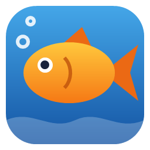
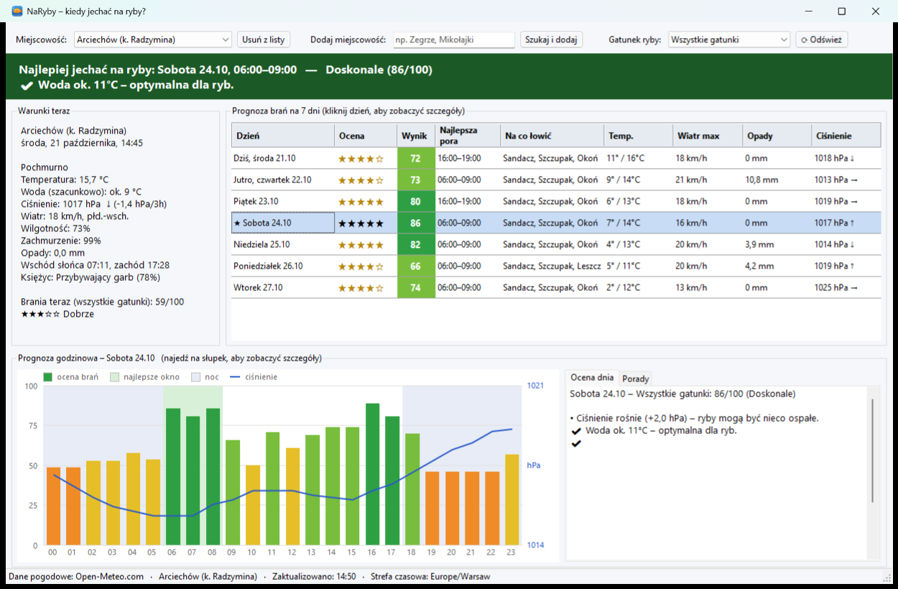
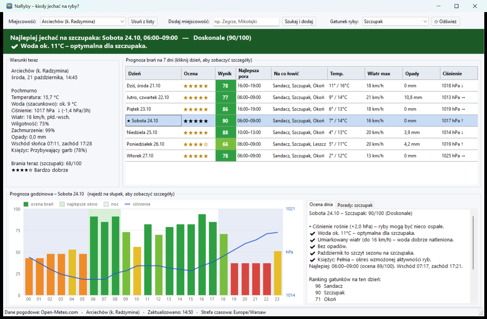
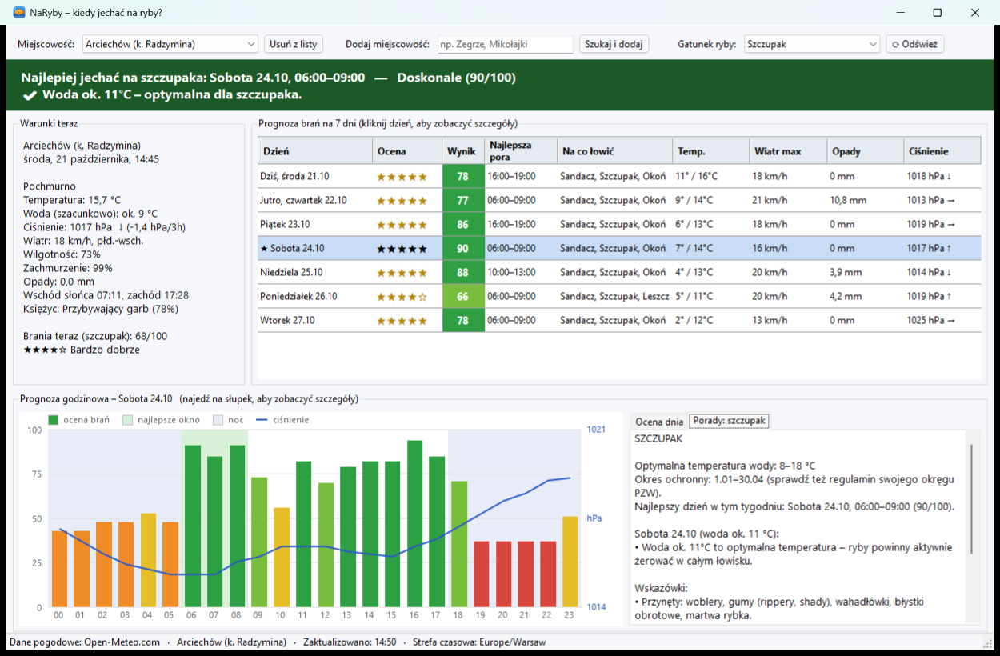

# NaRyby – kiedy jechać na ryby?

[](LICENSE)


Okienkowa aplikacja dla wędkarzy na Windows i macOS. Pobiera prognozę pogody dla wybranej
miejscowości i podpowiada, **kiedy najlepiej jechać na ryby** – ogólnie albo na konkretny
gatunek: szczupaka, sandacza, okonia, karpia, leszcza, lina, płoć, suma lub bolenia.



## Pobieranie

**[⬇ Pobierz NaRyby.zip](https://github.com/filipdab/NaRyby_win/releases/latest/download/NaRyby.zip)** –
najnowsza wersja z zakładki [Releases](https://github.com/filipdab/NaRyby_win/releases).

Rozpakuj archiwum i uruchom `NaRyby.exe` – instalacja nie jest potrzebna.
Przy pierwszym uruchomieniu Windows SmartScreen może ostrzec przed nieznanym wydawcą,
bo plik nie jest podpisany cyfrowo. Wybierz „Więcej informacji” → „Uruchom mimo to”.

### macOS

Pobierz z [Releases](https://github.com/filipdab/NaRyby_win/releases) archiwum
`NaRyby-mac-arm64.zip` (Mac z procesorem Apple M1 i nowszym) albo `NaRyby-mac-x64.zip` (Mac z procesorem Intel),
rozpakuj i przeciągnij `NaRyby.app` do folderu *Aplikacje*. .NET nie trzeba instalować – jest w paczce.

Aplikacja nie jest podpisana certyfikatem Apple, więc przy pierwszym uruchomieniu macOS ją zablokuje.
Otwórz *Ustawienia systemowe → Prywatność i ochrona* i kliknij „Otwórz mimo to” przy komunikacie o NaRyby
albo zdejmij blokadę w Terminalu:

```bash
xattr -dr com.apple.quarantine /Applications/NaRyby.app
```

## Funkcje

- **Prognoza na 7 dni** – ocena brań w skali 0–100, gwiazdki i najlepsze 3-godzinne okno w każdym dniu.
- **Rekomendacja** – baner z najlepszym dniem i porą wyjazdu oraz głównym powodem.
- **Gatunki ryb** – ocena i porady dopasowane do wybranego gatunku. Kolumna „Na co łowić”
  pokazuje gatunki z najlepszą prognozą na dany dzień.
- **Wykres godzinowy** – ocena brań, ciśnienie, pora nocna i najlepsze okno. Po najechaniu
  na słupek widać pogodę w danej godzinie.
- **Porady** – przynęty, łowiska, zachowanie ryb, wskazówka zależna od temperatury wody
  oraz informacja o okresie ochronnym.
- **Dowolne miejscowości** – wyszukiwarka dodaje jezioro, wieś lub miasto, a lista jest
  zapamiętywana. Domyślna lokalizacja: Arciechów koło Radzymina.
- **Automatyczne odświeżanie** co 30 minut.

| Ocena dnia dla wybranego gatunku | Porady dla wybranego gatunku |
|---|---|
|  |  |

## Jak liczona jest ocena

Każda godzina dostaje punkty na podstawie popularnej wiedzy wędkarskiej:

| Czynnik | Wpływ na ocenę |
|---|---|
| Ciśnienie | stabilne lub powoli spadające podnosi ocenę, gwałtowne zmiany ją obniżają |
| Wiatr | umiarkowany sprzyja drapieżnikom, cisza – linowi; silny i porywisty obniża ocenę |
| Kierunek wiatru | zachodni i południowo-zachodni sprzyja, wschodni przeszkadza |
| Temperatura wody | zgodna z preferencjami gatunku podnosi ocenę, za zimna lub za ciepła obniża |
| Opady | mżawka sprzyja, ulewa przeszkadza, burza mocno obniża ocenę |
| Pora dnia | świt i zmierzch sprzyjają; noc i południe zależnie od gatunku |
| Zachmurzenie | pochmurne niebo sprzyja drapieżnikom |
| Sezon | szczyt sezonu podnosi ocenę; w okresie ochronnym ocena wynosi 0 |
| Księżyc | nów i pełnia podnoszą ocenę |

Temperatura wody nie jest mierzona, tylko szacowana ze średniej temperatury powietrza
z ostatnich 3 dni. Preferencje gatunków są w [`Species.cs`](NaRyby_win/Species.cs),
a algorytm oceny w [`FishingAdvisor.cs`](NaRyby_win/FishingAdvisor.cs).

> [!NOTE]
> Ocena to szacunek, a nie gwarancja brań. Okresy ochronne mają charakter informacyjny –
> zawsze sprawdź aktualne przepisy i regulamin swojego okręgu PZW.

## Wymagania

- Windows 10 (wersja 1803 lub nowsza) albo Windows 11 – wbudowany .NET Framework 4.7.2 wystarcza.
- macOS 12 Monterey lub nowszy (Apple Silicon albo Intel).
- Połączenie z internetem.

## Budowanie

Sklonuj repozytorium, otwórz `NaRyby_win.slnx` w Visual Studio i uruchom (F5).
Wersję do udostępnienia zbudujesz z *Developer PowerShell for Visual Studio*:

```powershell
git clone https://github.com/filipdab/NaRyby_win.git
cd NaRyby_win
msbuild NaRyby_win\NaRyby_win.csproj -p:Configuration=Release
```

Wynik to `NaRyby_win\bin\Release\NaRyby_win.exe` wraz z plikiem `NaRyby_win.exe.config`.
Program nie potrzebuje dodatkowych bibliotek – wystarczy skopiować oba pliki na inny komputer.

Ikona (`NaRyby_win/NaRyby.ico`) jest generowana skryptem [`tools/make_icon.ps1`](tools/make_icon.ps1).

### macOS

Wersja na macOS (`NaRyby_mac`) korzysta z [Avalonia UI](https://avaloniaui.net/) i .NET 8.
Logika – pogoda, ocena brań, gatunki i lista miejscowości – to te same pliki co w wersji Windows,
osobny jest tylko interfejs. Potrzebny jest [.NET 8 SDK](https://dotnet.microsoft.com/download/dotnet/8.0)
(np. `brew install --cask dotnet-sdk`).

```bash
dotnet run --project NaRyby_mac        # uruchomienie z kodu
./tools/build_mac.sh                   # NaRyby.app + dist/mac/NaRyby-mac-arm64.zip i -x64.zip
./tools/build_mac.sh arm64             # tylko Apple Silicon
```

Skrypt buduje samodzielne paczki (z wbudowanym .NET) i podpisuje je podpisem ad-hoc, którego
wymagają Maki z procesorem Apple. Ikonę macOS (`NaRyby_mac/macos/NaRyby.icns`) generuje
[`tools/make_icon_mac.py`](tools/make_icon_mac.py).

## Struktura projektu

| Plik | Zawartość |
|---|---|
| `MainForm.cs` | główne okno |
| `ScoreChart.cs` | wykres godzinowy |
| `CityPickerForm.cs` | wybór miejscowości, gdy wyszukiwanie zwróci kilka wyników |
| `WeatherService.cs` | pobieranie prognozy i wyszukiwanie miejscowości (Open-Meteo) |
| `FishingAdvisor.cs` | ocena warunków i jej uzasadnienie |
| `Species.cs` | preferencje i porady dla gatunków |
| `MoonPhase.cs` | fazy Księżyca |
| `CityStore.cs` | lista miejscowości zapisywana w `%AppData%\NaRyby\miasta.txt` (macOS: `~/Library/Application Support/NaRyby/miasta.txt`) |

Wersja macOS (`NaRyby_mac/`) dołącza powyższe pliki logiki i ma własny interfejs:

| Plik | Zawartość |
|---|---|
| `MainWindow.cs` | główne okno |
| `ScoreChart.cs` | wykres godzinowy |
| `Dialogs.cs` | komunikaty i wybór miejscowości |
| `macos/Info.plist`, `macos/NaRyby.icns` | opis i ikona pakietu `NaRyby.app` |

## Dane pogodowe

Prognoza pogody i wyszukiwanie miejscowości pochodzą z [Open-Meteo.com](https://open-meteo.com/)
(licencja [CC BY 4.0](https://creativecommons.org/licenses/by/4.0/)). Usługa nie wymaga klucza API.

## Licencja

Projekt jest udostępniony na licencji [MIT](LICENSE).
